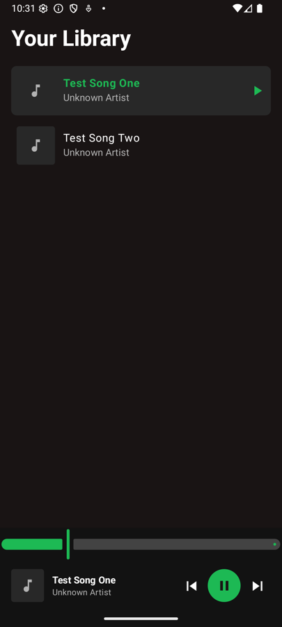
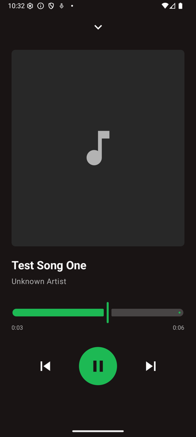
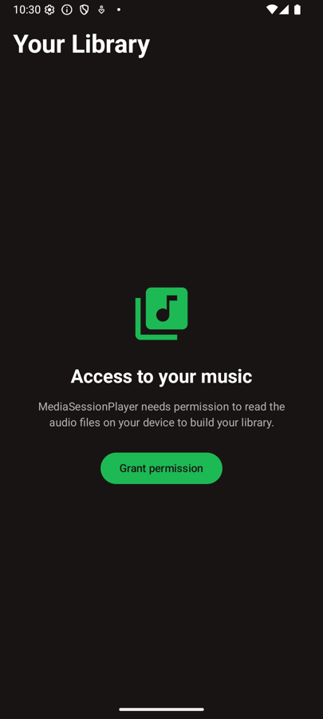

# MediaSessionPlayer

MediaSessionPlayer is a local music player for Android built with Kotlin, Jetpack Compose and Media3. It offers background playback, media notification controls and a Spotify-inspired interface to enjoy the music stored on your device.

## Screenshots

### Library & Now Playing Screens
 

### Permission Screen


## Tech Stack

- **[Kotlin](https://developer.android.com/kotlin):** Modern language for Android development.

- **[Jetpack Compose](https://developer.android.com/jetpack/compose):** Declarative UI toolkit for native Android UIs.

- **[Media3](https://developer.android.com/media/media3):** ExoPlayer, MediaSessionService and MediaController for background playback and system media controls.

- **[Hilt](https://dagger.dev/hilt/):** Dependency injection library for clean and modular code.

- **[Coil](https://coil-kt.github.io/coil/):** Image loading library for efficient image handling.

- **[Kotlin Coroutines & Flow](https://kotlinlang.org/docs/coroutines-overview.html):** Asynchronous work and reactive streams for the player state and the music library.

- **[MediaStore](https://developer.android.com/training/data-storage/shared/media):** Access to the audio files stored on the device, with live updates when the library changes.

- **Clean Architecture, SOLID Principles:** Design approach for maintainable and scalable code.

- **GitFlow:** Git branching model for project release management.

- **MVVM:** Architecture for separating UI and business logic.

## How to Run the Project

1. Clone this repository to your local machine.
2. Open the project in Android Studio.
3. Connect your Android device or use an emulator.
4. Build and run the project.

## Configuration

No API keys are needed. The app reads the music stored on your device, so make sure it has some audio files. On an emulator, you can add songs with:

```plaintext
adb push song.mp3 /sdcard/Music/
```

## Features

- **Music Library:** Browse every song on your device with its title, artist and album art. The library updates automatically when songs are added or removed.

- **Background Playback:** Keep listening when the app is in the background, with controls in the notification, the lock screen and Bluetooth or headset buttons.

- **Mini Player:** Control playback and seek through the current song without leaving the library.

- **Now Playing:** Full screen player with album art, a seek bar and playback controls.

- **Permissions:** Clear handling of the audio permission, including a shortcut to the system settings when it has been permanently denied.

## Contributing

We welcome contributions! If you want to contribute to MediaSessionPlayer, please fork the repository and create a pull request. For major changes, please open an issue first to discuss the proposed changes.

License
--------

    MIT License
    Copyright (c) 2025 André Salazar
    Permission is hereby granted, free of charge, to any person obtaining a copy
    of this software and associated documentation files (the "Software"), to deal
    in the Software without restriction, including without limitation the rights
    to use, copy, modify, merge, publish, distribute, sublicense, and/or sell
    copies of the Software, and to permit persons to whom the Software is
    furnished to do so, subject to the following conditions:

    The above copyright notice and this permission notice shall be included in all
    copies or substantial portions of the Software.

    THE SOFTWARE IS PROVIDED "AS IS", WITHOUT WARRANTY OF ANY KIND, EXPRESS OR
    IMPLIED, INCLUDING BUT NOT LIMITED TO THE WARRANTIES OF MERCHANTABILITY,
    FITNESS FOR A PARTICULAR PURPOSE AND NONINFRINGEMENT. IN NO EVENT SHALL THE
    AUTHORS OR COPYRIGHT HOLDERS BE LIABLE FOR ANY CLAIM, DAMAGES OR OTHER
    LIABILITY, WHETHER IN AN ACTION OF CONTRACT, TORT OR OTHERWISE, ARISING FROM,
    OUT OF OR IN CONNECTION WITH THE SOFTWARE OR THE USE OR OTHER DEALINGS IN THE
    SOFTWARE.
